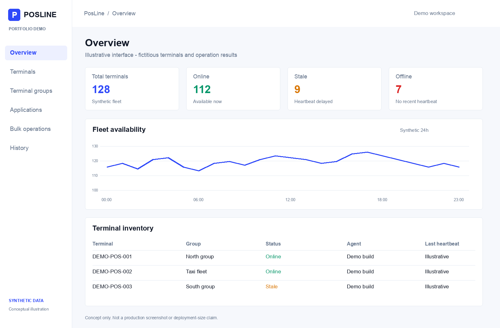
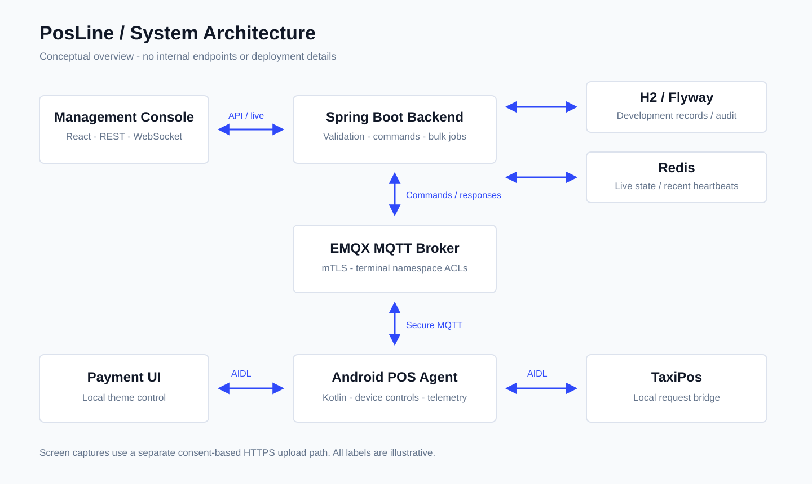
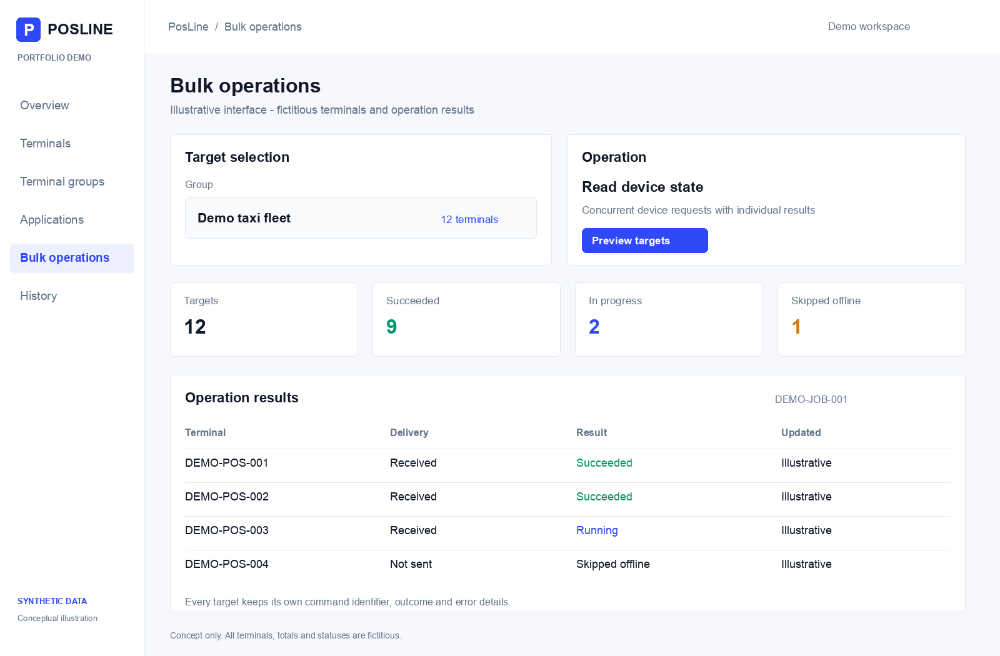

# PosLine

### Android POS Device Management Platform

A portfolio overview of a full-stack Mobile Device Management platform developed during my **Software Engineer Internship at Token Finansal Teknolojiler**, within the **Operating Systems and Security Department**, July-August 2026.

PosLine brings device monitoring, application deployment, troubleshooting, and fleet operations into one management console.

> This is a documentation-only showcase. The implementation remains private. The illustrations below are newly created conceptual demonstrations with synthetic data, not screenshots of the private application or evidence of a production deployment.

## My Contributions

- Developed the Android POS Agent, Spring Boot backend, and React management console for an end-to-end device management workflow.
- Implemented MQTT-based commands with acknowledgements, expiry, structured errors, and auditable final results.
- Built secure device communication around mTLS, certificate identity, and terminal-scoped MQTT access controls.
- Implemented Redis-backed live state, heartbeat-based device availability, and WebSocket updates for the console.
- Added terminal grouping and controlled parallel bulk operations with per-device results.
- Developed remote application inventory and management, APK download verification and installation workflows.
- Implemented location and cellular telemetry, terminal parameters, kiosk locking, and user-consented screen capture.
- Built companion Android applications and signature-protected AIDL communication for local integration.

These contributions describe my work on a collaborative internship project; this showcase does not claim sole authorship of every component.

## Architecture

The console reads operational data through REST and receives live updates over WebSocket. The backend validates and publishes commands through EMQX; each POS Agent communicates within its own MQTT namespace using mTLS. H2/Flyway stores development records and audit history, while Redis holds frequently changing live state.

On each terminal, signature-protected AIDL/Binder interfaces connect the POS Agent to companion Android applications. Screen capture uses user consent and a separate HTTPS upload path; image bytes do not travel through MQTT.

See [the architecture overview](docs/architecture.md) for responsibilities and data flow.

## Capabilities

| Area | Implemented workflows |
| --- | --- |
| Monitoring | Heartbeats, online/stale/offline states, device snapshots and operational history |
| Fleet operations | Custom groups, automatic groups, bulk preview, controlled parallel dispatch and per-target outcomes |
| Device control | Connectivity settings, brightness, audio, reboot and capability-dependent kiosk locking |
| Applications | Inventory, package details, enable/disable, launch/stop, storage cleanup and supported uninstall paths |
| APK delivery | Catalog, download progress, SHA-256 and signing-certificate verification, install progress |
| Diagnostics | Location, cellular telemetry and manually requested screen capture with user consent |
| Configuration | Typed terminal parameters and companion payment UI theme management |
| Companion apps | Payment UI, TaxiPos and launcher integrations |

Device-control capabilities depend on the Android version, ROM and permissions available on the terminal.

## Technology Stack

| Layer | Technologies |
| --- | --- |
| Android | Kotlin, Jetpack Compose, Android SDK, AIDL/Binder, DataStore, Android Keystore |
| Backend | Java, Spring Boot, REST, Spring Data JPA, Flyway |
| Communication | MQTT, EMQX, WebSocket, HTTPS, mTLS/X.509 |
| Data | H2 development persistence, Redis live state |
| Frontend | React, JavaScript, Vite |

## Fleet Operations Illustration

All terminal labels, totals, operation identifiers and status values in these illustrations are fictitious. No private source files, internal documents, device identifiers, certificates, keys, database snapshots or real telemetry are included.

## Engineering Focus

- Explicit component boundaries and typed command contracts.
- Failure-aware command lifecycle and reconnect handling.
- Per-terminal identity and namespace isolation.
- Fleet-oriented workflows rather than repetitive single-device operations.
- Separation of persistent audit records and frequently changing live data.

This showcase makes no production fleet-size, load-test, cost-saving or customer-impact claims. It is a portfolio description, not a runnable distribution or an official company publication.

## Source Availability

The original source repository remains private. This repository contains only the project narrative, a high-level conceptual diagram, and synthetic illustrations. It does not grant rights to the underlying implementation or company branding.
